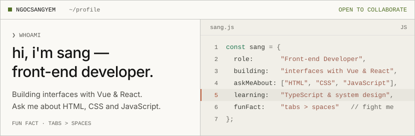
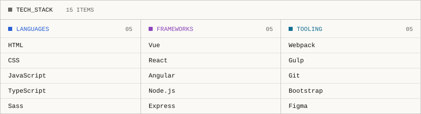
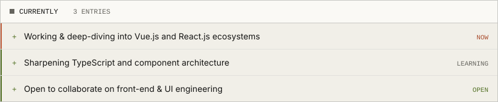
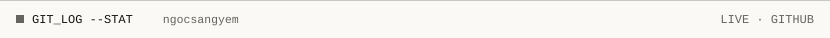
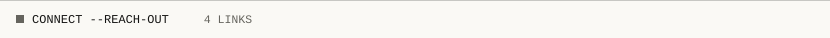
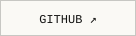
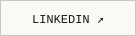
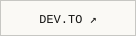
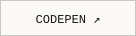
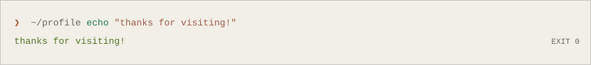

<!--
  ngocsangyem — GitHub profile README
  Warm Terminal · https://github.com/ngocsangyem/warm-terminal-design
  Flat · ruled · square · mono labels over sans text · one orange accent
  Every panel ships in a dark + light variant via <picture>.
-->

<picture>
  <source media="(prefers-color-scheme: dark)" srcset="./assets/header-dark.svg">
  
</picture>

<picture>
  <source media="(prefers-color-scheme: dark)" srcset="./assets/stack-dark.svg">
  
</picture>

<picture>
  <source media="(prefers-color-scheme: dark)" srcset="./assets/currently-dark.svg">
  
</picture>

<picture>
  <source media="(prefers-color-scheme: dark)" srcset="./assets/section-stats-dark.svg">
  
</picture>

<picture>
  <source media="(prefers-color-scheme: dark)" srcset="https://github-readme-stats.vercel.app/api?username=ngocsangyem&amp;show_icons=true&amp;count_private=true&amp;border_radius=0&amp;bg_color=141413&amp;title_color=faf9f5&amp;text_color=b0aea5&amp;icon_color=87867f&amp;ring_color=d97757&amp;border_color=393937">
  
</picture>
<picture>
  <source media="(prefers-color-scheme: dark)" srcset="https://github-readme-streak-stats.herokuapp.com/?user=ngocsangyem&amp;border_radius=0&amp;background=141413&amp;border=393937&amp;stroke=393937&amp;ring=d97757&amp;fire=d97757&amp;currStreakNum=faf9f5&amp;sideNums=faf9f5&amp;currStreakLabel=d97757&amp;sideLabels=b0aea5&amp;dates=87867f">
  
</picture>

<picture>
  <source media="(prefers-color-scheme: dark)" srcset="https://github-readme-stats.vercel.app/api/top-langs/?username=ngocsangyem&amp;layout=compact&amp;border_radius=0&amp;bg_color=141413&amp;title_color=faf9f5&amp;text_color=b0aea5&amp;icon_color=87867f&amp;ring_color=d97757&amp;border_color=393937">
  
</picture>

<picture>
  <source media="(prefers-color-scheme: dark)" srcset="./assets/section-connect-dark.svg">
  
</picture>

<a href="https://github.com/ngocsangyem"><picture><source media="(prefers-color-scheme: dark)" srcset="./assets/btn-github-dark.svg"></picture></a>
<a href="https://linkedin.com/in/ngocsangyem"><picture><source media="(prefers-color-scheme: dark)" srcset="./assets/btn-linkedin-dark.svg"></picture></a>
<a href="https://dev.to/ngocsangyem"><picture><source media="(prefers-color-scheme: dark)" srcset="./assets/btn-devto-dark.svg"></picture></a>
<a href="https://codepen.io/ngocsangyem"><picture><source media="(prefers-color-scheme: dark)" srcset="./assets/btn-codepen-dark.svg"></picture></a>

<picture>
  <source media="(prefers-color-scheme: dark)" srcset="./assets/footer-dark.svg">
  
</picture>

